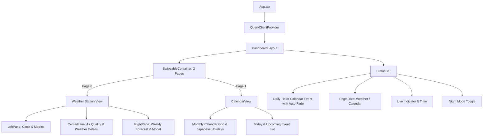

# DESIGN.md - Frontend & System Design Document

> **Project:** Daily Station (Raspberry Pi 卓上ウェザーステーション＆スマートクロック)  
> **Target Display:** 7インチ タッチスクリーン (800 × 480 px 固定解像度)  
> **Status:** Active / Living Document  
> **Frameworks:** React 19, Vite 8, Tailwind CSS v4, shadcn/ui, TanStack Query v5  
> **Last Updated:** 2026-10-15

---

## 1. 概要とデザイン原則 (Executive Summary & Principles)

### 1.1 プロジェクト背景

本システムは、Raspberry Pi 4 および 800×480 タッチディスプレイ上で常時稼働する「SwitchBot スマートデイリーステーション風」の卓上環境ダッシュボード端末です。MagicMirror² 等の過剰なフレームワークを排し、Vite + React による高レスポンスかつ保守性の高い Web フロントエンドを Chromium キオスクモードで運用します。

### 1.2 コアデザイン原則 (Core Design Principles)

1. **800×480 完全固定ビューポート (Zero Overflow)**:
   - 縦横のスクロールバーおよび OS UI を完全排除。すべての情報が 800×480 内に過不足なく美しく収まること。
2. **常時稼働スマートクロックの絶対的自律性 (Self-Correcting Precision Clock)**:
   - 時計は人間が「リロード」をしなくても**永久にミリ秒単位で現在時刻に自己同期し続ける**こと。
   - `setInterval` のようなドリフト（累積ズレ）やブラウザのバックグラウンド間引き・OSスリープに屈しない、次の秒の変わり目（`1000 - Date.now() % 1000`）を狙った自己補正ループを採用。
   - タブ復帰・画面復帰（`visibilitychange`, `focus`, `pageshow`）を常時検知し、瞬時に実時刻へ再吸着するフェイルセーフを保証する。
3. **横スワイプ＆マルチビュー (Seamless Carousel Gestures)**:
   - タッチ操作（またはマウスクリックドラッグ）による左右スワイプで、メインのウェザーステーション画面と月間カレンダー画面をスムーズに切り替え可能。
   - 画面下部のインジケータードットでも瞬時に画面遷移可能。
4. **生活密着型「今日の一言」アシスタント**:
   - 気温・降水・寒暖差・紫外線・室内環境・時間帯から、生活に役立つ実用的なアドバイス（傘の要否、服装の工夫、熱中症や乾燥予防等）を自動生成。
5. **情報の一目性と単位の視認性 (Legibility & Unit Breathing Room)**:
   - 1行に無理に情報を詰め込んで単位（`℃` や `%`）を圧迫・潰さないこと。
   - ラベル（屋外／室内）とその計測値を 2 段ブロック構造にすることで、横幅のゆとりとカード上下の空間充填を両立する。
6. **低刺激・常設最適化 (Night Mode & Low Power)**:
   - 就寝時にも眩しくないダークトーン配色（ナイトモード）の即時切替。
7. **位置情報の秘匿性 (Privacy First)**:
   - 観測地点（緯度・経度・地域名）はコードベースにハードコードせず、`.env.local` 経由で注入。

---

## 2. 画面レイアウト＆スペーシング仕様 (800px × 480px 固定)

### 2.1 画面 1: メインウェザーステーション (800px × 438px)

```
+-----------------------------------------------------------------------------+
| メイン表示領域 (800px × 438px, 外側パディング: px-2.5 pt-2 pb-1.5, gap-2)   |
| +---------------------+ +-----------------------+ +-----------------------+ |
| | [左ペイン: 268px]   | | [中央ペイン: 288px]   | | [右ペイン: 236px]     | |
| | ・日付 (14px)       | | 【空気質タイル】      | | 【週間天気予報】      | |
| | ・デジタル時計      | |  AQI / PM2.5 / 花粉   | |  今日 (ハイライト)    | |
| | ・今日天気サマリー  | | --------------------- | |  明日以降 6日分リスト | |
| | 【屋外温湿度ブロック| | 【気象詳細リスト】    | |  [Icon] 降水  曜日  高/低℃|
| |   屋外              | |  風速 / 風向 / UV指数 | |  (℃が潰れない80px幅)  | |
| |   🌡 22.8℃  💧 76%  | |  降水確率 / 視程/気圧 | |                       | |
| | 【室内温湿度ブロック| |                       | |                       | |
| |   室内        😊    | |                       | |                       | |
| |   🌡 22.8℃  💧 48%  | |                       | |                       | |
| | ------------------- | |                       | |                       | |
| |  日の出 / 日の入り  | |                       | |                       | |
| +---------------------+ +-----------------------+ +-----------------------+ |
+-----------------------------------------------------------------------------+
| 下部ステータスバー (800px × 42px, px-3 border-t)                             |
| [今日の一言: ☂️ 傘をお持ちください]  [● ○]  [最終更新 16:55 ◯]  [🌙 ナイト]  |
+-----------------------------------------------------------------------------+
```

### 2.2 画面 2: 月間カレンダー＆スケジュール (800px × 438px, スワイプで切替)

```
+-----------------------------------------------------------------------------+
| カレンダー表示領域 (800px × 438px, px-2.5 pt-2 pb-1.5, gap-2)               |
| +-------------------------------------+ +---------------------------------+ |
| | [左ペイン: 456px]                   | | [右ペイン: 316px]               | |
| | 【年月ヘッダー & 月送りボタン】     | | 【今日の日時・天気ミニカード】  | |
| |  2026年 10月    [今日] [<] [>]      | |  10月15日(木) 16:15  ☀️ 21.2℃   | |
| | ----------------------------------- | | ------------------------------- | |
| | 【6週カレンダーマトリクス】         | | 【本日の予定リスト】            | |
| |  日  月  火  水  木  金  土         | |  ・10:00 [仕事] チーム朝会      | |
| |  ・祝日（赤字・祝日名付き）         | |  ・14:00 [仕事] プロジェクト定例| |
| |  ・今日（サークルハイライト）       | |  ・19:00 [家庭] 夕食ミーティング| |
| |  ・予定あり日付（ドットインジケータ）| |                                 | |
| +-------------------------------------+ +---------------------------------+ |
+-----------------------------------------------------------------------------+
| 下部ステータスバー (800px × 42px)                                            |
| [次の予定: 19:00 - 夕食ミーティング]   [○ ●]  [最終更新 16:55 ◯]  [🌙 ナイト]  |
+-----------------------------------------------------------------------------+
```

### 2.3 温湿度ブロック＆数値列の視認性保証

- **左ペイン温湿度ブロック (2段構造)**:
  - 横1行の詰め込みを廃止し、上段ラベル＋下段均等配置によって `℃` と `%` の単位に呼吸スペースを確保。
- **右ペイン週間気温列**:
  - `w-20` (80px) に固定し、最高/最低気温と `℃` が絶対に折り返さず整列。

---

## 3. タイポグラフィ＆情報密度 (Typography & Visual Scale)

| 要素                      | フォントサイズ・ウェイト                                     | 意図・改善点                                             |
| :------------------------ | :----------------------------------------------------------- | :------------------------------------------------------- |
| **左ペイン日付**          | `text-sm font-semibold` (`14px`)                             | 部屋の離れた場所からでも今日の日付・曜日が即座に判読可能 |
| **デジタル時計 (時:分)**  | `text-5xl font-extrabold tracking-tight`                     | 主役となる時刻。等幅フォントで揺らぎを防止               |
| **デジタル時計 (秒)**     | `text-2xl font-bold text-muted-foreground`                   | 時:分と同じベースライン（下揃え）にスマートに整列        |
| **屋内外温湿度 (数値)**   | **`text-base font-extrabold font-mono` (`16px`)**            | 2段ブロック化により拡大。`℃` と `%` が潰れず快適         |
| **快適度アイコン**        | `text-sm` (絵文字 😊)                                        | 室内ラベル横に自然に配置                                 |
| **空気質 (AQI / PM2.5)**  | `text-lg font-bold font-mono` (`18px`)                       | タイル内の空間を適正に充填                               |
| **気象詳細リスト**        | ラベル `text-xs font-medium` / 数値 `text-sm font-bold`      | アイコンと数値のメリハリをつけ、間延びを解消             |
| **週間予報 (曜日・気温)** | 曜日 `text-sm font-bold` / 気温 `text-sm font-bold` (幅80px) | `℃` 単位を潰さず 80px 幅で優雅に収容                     |
| **カレンダー日付セル**    | `text-xs font-mono`                                          | 6週グリッドを均等に整列、祝日・日曜は赤字表示            |

---

## 4. コンポーネント構成と階層 (Component Architecture)



---

## 5. AI エージェント＆開発者向けコーディング規約 (Rules for AI & Devs)

1. **常時稼働スマートクロックの自律性**:
   - 時計機能はリロード不要で永続動作すること。
   - スリープ復帰・非表示復帰時の自動リカバリイベントハンドラを絶対に削除しないこと。
2. **レイアウト不変性の厳守 (800x480)**:
   - 全体枠は `w-[800px] h-[480px] overflow-hidden` を維持すること。
   - 文字列や数値には必ず `whitespace-nowrap` を指定し、度記号（`°`）やパーセント（`%`）が絶対に改行・縦落ちしないようにすること。
3. **単位記号の余白保証 (Unit Breathing Room)**:
   - `℃` や `%` などの単位記号を無理な横1行詰め込みで押し潰さないこと。
   - 列幅は実測フォント幅に対して余裕を持たせること。
4. **コミット規約**:
   - Conventional Commits (`feat:`, `fix:`, `chore:`, `docs:`) に従うこと。
