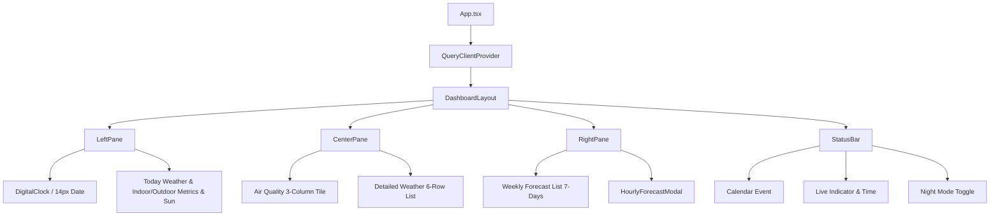

# DESIGN.md - Frontend & System Design Document

> **Project:** Daily Station (Raspberry Pi 卓上ウェザーステーション＆スマートクロック)  
> **Target Display:** 7インチ タッチスクリーン (800 × 480 px 固定解像度)  
> **Status:** Active / Living Document  
> **Frameworks:** React 19, Vite 8, Tailwind CSS v4, shadcn/ui, TanStack Query v5  
> **Last Updated:** 2026-10-13

---

## 1. 概要とデザイン原則 (Executive Summary & Principles)

### 1.1 プロジェクト背景

本システムは、Raspberry Pi 4 および 800×480 タッチディスプレイ上で常時稼働する「SwitchBot スマートデイリーステーション風」の卓上環境ダッシュボード端末です。MagicMirror² 等の過剰なフレームワークを排し、Vite + React による高レスポンスかつ保守性の高い Web フロントエンドを Chromium キオスクモードで運用します。

### 1.2 コアデザイン原則 (Core Design Principles)

1. **800×480 完全固定ビューポート (Zero Overflow)**:
   - 縦横のスクロールバーおよび OS UI を完全排除。すべての情報が 800×480 内に過不足なく美しく収まること。
2. **情報の一目性 (Glanceability & Proportion)**:
   - 部屋の離れた場所（1〜2m先）から見ても「日付」「時刻」「屋内外の温度」「週間天気」が一目で飛び込んでくるフォントスケール。
   - スカスカな「無駄な余白」を排除しつつ、画面外縁やカード間には適切な「呼吸感（外側パディング）」を確保する。
3. **SwitchBot ライクな洗練と親しみやすさ**:
   - 角丸カード（`rounded-2xl`）、整理された 1 行グリッド、快適度スマイルフェイス（😊）による温かみのある情報提示。
4. **低刺激・常設最適化 (Night Mode & Low Power)**:
   - 就寝時にも眩しくないダークトーン配色（ナイトモード）の即時切替。
5. **位置情報の秘匿性 (Privacy First)**:
   - 観測地点（緯度・経度・地域名）はコードベースにハードコードせず、`.env.local` 経由で注入。

---

## 2. 画面レイアウト＆スペーシング仕様 (800px × 480px 固定)

```
+-----------------------------------------------------------------------------+
| メイン表示領域 (800px × 438px, 外側パディング: px-2.5 pt-2 pb-1.5, gap-2)   |
| +---------------------+ +-----------------------+ +-----------------------+ |
| | [左ペイン]          | | [中央ペイン]          | | [右ペイン]            | |
| | 幅: 268px           | | 幅: 288px             | | 幅: 236px             | |
| |                     | |                       | |                       | |
| | ・日付 (14px 太字)  | | 【空気質タイル】      | | 【週間天気予報】      | |
| | ・デジタル時計      | |  AQI / PM2.5 / 花粉   | |  今日 (ハイライト)    | |
| | ・今日天気サマリー  | |  (大文字スケール)     | |  明日以降 6日分リスト | |
| | 【屋内外温湿度】    | | --------------------- | |  (14px 視認性重視)    | |
| |  屋外: 22.8℃ 76%   | | 【気象詳細リスト】    | |  (アイコン/降水/気温) | |
| |  室内: 22.8℃ 48% 😊| |  風速 / 風向 / UV指数 | |  (タップで詳細モーダル| |
| | ------------------- | |  降水確率 / 視程/気圧 | |                       | |
| |  日の出 / 日の入り  | |  (程よい行高＆整列)   | |                       | |
| +---------------------+ +-----------------------+ +-----------------------+ |
+-----------------------------------------------------------------------------+
| 下部ステータスバー (800px × 42px, px-3 border-t)                             |
| [カレンダー予定: 次のミーティング 19:00]       [最終更新 16:55 ◯] [🌙 ナイト]  |
+-----------------------------------------------------------------------------+
```

### 2.1 余白とパディングの黄金比 (Spacing & Padding Hierarchy)

- **画面外枠パディング (Outer Canvas Padding)**:
  - 左右: `px-2.5` (10px)、上部: `pt-2` (8px)、下部: `pb-1.5` (6px)
  - ディスプレイ額縁とカードの境界に十分なマージンを設け、窮屈感を解消。
- **ペイン間ギャップ (Column Gap)**: `gap-2` (8px)
- **ペイン内部ギャップ (Card Gap)**: `gap-2` (8px)
- **カード内パディング (Internal Padding)**:
  - 時計カード: `p-2.5` (無駄な上下余白を削り、日付・時刻のフォントサイズを拡大)
  - 統合天気・温湿度カード: `p-3` (温湿度ブロックのフォントを拡大しスカスカ感を解消)
  - 空気質タイル: `p-2.5` (AQI/PM2.5 数値を `text-lg`〜`text-xl` へ引き上げ)
  - 気象詳細リスト: カード `p-2.5`、各行 `py-1.5 px-2.5` でゆとりのある行間
  - 週間予報: カード `p-2.5`、各ボタン行 `py-1.5 px-2` でタッチしやすい高さ（約 46px）を確保

### 2.2 横幅比率配分

- **左ペイン (268px)**: 時計、日付、現在天気、屋内外温湿度、日の出日没
- **中央ペイン (288px)**: 空気質（AQI, PM2.5, 花粉）＋ 気象詳細パラメータリスト
- **右ペイン (236px)**: 今日＋週間予報（7日分）

---

## 3. タイポグラフィ＆情報密度 (Typography & Visual Scale)

### 3.1 視認性向上スケール (Glanceability Scale)

| 要素                      | フォントサイズ・ウェイト                                | 意図・改善点                                                           |
| :------------------------ | :------------------------------------------------------ | :--------------------------------------------------------------------- |
| **左ペイン日付**          | `text-sm font-semibold` (`14px`)                        | 11pxから拡大。部屋の離れた場所からでも今日の日付・曜日が即座に判読可能 |
| **デジタル時計 (時:分)**  | `text-5xl font-extrabold tracking-tight`                | 主役となる時刻。等幅フォントで揺らぎを防止                             |
| **デジタル時計 (秒)**     | `text-2xl font-bold text-muted-foreground`              | 時:分と同じベースライン（下揃え）にスマートに整列                      |
| **屋内外温湿度 (数値)**   | `text-sm font-bold font-mono` (`14px`)                  | 12pxから拡大。屋外と室内の温度差を一目で比較可能                       |
| **快適度アイコン**        | `text-base` (絵文字 😊)                                 | 視覚的な癒やしと直感的な室内環境の把握                                 |
| **空気質 (AQI / PM2.5)**  | `text-lg font-bold font-mono` (`18px`)                  | タイル内の無駄な空間を埋め、空気状態を強調                             |
| **気象詳細リスト**        | ラベル `text-xs font-medium` / 数値 `text-sm font-bold` | アイコンと数値のメリハリをつけ、間延びを解消                           |
| **週間予報 (曜日・気温)** | 曜日 `text-sm font-bold` / 気温 `text-sm font-bold`     | 小さすぎて読みづらかった文字を 14px に統一し、行内のバランスを最適化   |

### 3.2 カラーパレット (Tailwind CSS v4 / CSS Variables)

| 用途                      | ライトモード (通常)                 | ナイトモード (Dark)                           |
| :------------------------ | :---------------------------------- | :-------------------------------------------- |
| **背景 (Background)**     | `bg-zinc-100` / `bg-background`     | `dark:bg-zinc-950`                            |
| **カード背景 (Card)**     | `bg-card/95` (白系)                 | `dark:bg-zinc-900/90`                         |
| **カード枠線 (Border)**   | `border-border/60` (洗練された薄枠) | `dark:border-zinc-800`                        |
| **アクセント / アイコン** | `text-primary` (`#2563eb` 等)       | `dark:text-blue-400`                          |
| **屋外気温 / 最高気温**   | `text-rose-500`                     | `dark:text-rose-400`                          |
| **室内快適 / 湿度**       | `text-emerald-500` / `text-sky-500` | `dark:text-emerald-400` / `dark:text-sky-400` |

---

## 4. コンポーネント構成と階層 (Component Architecture)



---

## 5. データフローと外部API連携 (Data Flow)

1. **Open-Meteo Forecast API**:
   - 気温、体感、湿度、天気コード、風速、風向、気圧、視程、日出日没、週間最高/最低、時間帯別予報
2. **Open-Meteo Air Quality API**:
   - European AQI, PM2.5, PM10
3. **室内環境センサー (Phase 1: Mock → Phase 2: BLE/GPIO)**:
   - `useIndoorEnvironment` によるリアルな温湿度シミュレーション
4. **自動更新戦略**:
   - 15分間隔バックグラウンド更新、エラー時3回リトライ、5分間キャッシュ鮮度維持

---

## 6. AI エージェント＆開発者向けコーディング規約 (Rules for AI & Devs)

1. **レイアウト不変性の厳守 (800x480)**:
   - 全体枠は `w-[800px] h-[480px] overflow-hidden` を維持すること。
   - 文字列や数値には必ず `whitespace-nowrap` を指定し、度記号（`°`）やパーセント（`%`）が絶対に改行・縦落ちしないようにすること。
2. **余白とフォントのバランス管理**:
   - 本書で定めた余白階層（外側 `px-2.5 pt-2 pb-1.5`、カード間 `gap-2`、主要テキスト `14px`）を遵守し、間延びや窮屈感を生じさせないこと。
3. **位置情報の秘匿**:
   - 座標や地域名は `.env.local` 経由で取得すること。
4. **コミット規約**:
   - Conventional Commits (`feat:`, `fix:`, `chore:`, `docs:`) に従うこと。
