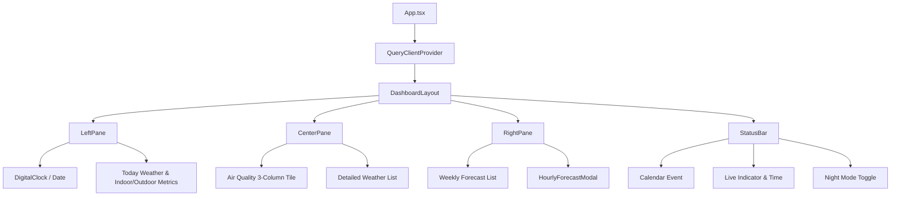

# DESIGN.md - Frontend & System Design Document

> **Project:** Daily Station (Raspberry Pi 卓上ウェザーステーション＆スマートクロック)  
> **Target Display:** 7インチ タッチスクリーン (800 × 480 px 固定解像度)  
> **Status:** Active / Living Document  
> **Frameworks:** React 19, Vite 8, Tailwind CSS v4, shadcn/ui, TanStack Query v5  
> **Last Updated:** 2026-10-13

---

## 1. 概要とデザイン原則 (Executive Summary & Principles)

### 1.1 プロジェクト背景

本システムは、Raspberry Pi 4 および 800×480 タッチディスプレイ上で常時稼働する「SwitchBot スマートデイリーステーション風」の卓上環境ダッシュボード端末です。MagicMirror² 等の過剰なフレームワークを排し、Vite + React による高レスポンスかつ保守性の高い Web フロントエンドを Chromium キオスクモードで運用します。

### 1.2 コアデザイン原則 (Core Design Principles)

1. **800×480 完全固定ビューポート (Zero Overflow)**:
   - 縦横のスクロールバーおよび OS UI を完全排除。すべての情報が 800×480 内に過不足なく美しく収まること。
2. **情報の一目性 (Glanceability)**:
   - 部屋のどこから見ても「時刻」「現在の天気」「屋内外の温湿度」「空気質」が即座に把握できるコントラストとフォントスケール。
3. **SwitchBot ライクな洗練と親しみやすさ**:
   - 角丸カード（`rounded-2xl`）、整理された 1 行グリッド、快適度スマイルフェイス（😊）による温かみのある情報提示。
4. **低刺激・常設最適化 (Night Mode & Low Power)**:
   - 就寝時にも眩しくないダークトーン配色（ナイトモード）の即時切替。
5. **位置情報の秘匿性 (Privacy First)**:
   - 観測地点（緯度・経度・地域名）はコードベースにハードコードせず、`.env.local` 経由で注入。

---

## 2. 画面レイアウト仕様 (800px × 480px 固定)

```
+-----------------------------------------------------------------------------+
| メイン表示領域 (800px × 438px)                                              |
| +---------------------+ +-----------------------+ +-----------------------+ |
| | [左ペイン]          | | [中央ペイン]          | | [右ペイン]            | |
| | 幅: 270px           | | 幅: 290px             | | 幅: 240px             | |
| |                     | |                       | |                       | |
| | ・日付 / 曜日       | | 【空気質タイル】      | | 【週間天気予報】      | |
| | ・太字デジタル時計  | |  AQI / PM2.5 / 花粉   | |  今日 (ハイライト)    | |
| | ・今日天気サマリー  | | --------------------- | |  明日以降 6日分リスト | |
| | 【屋内外温湿度】    | | 【気象詳細リスト】    | |  (アイコン/降水/気温) | |
| |  屋外: 22.8℃ 76%   | |  風速 / 風向 / UV指数 | |  (タップで詳細モーダル| |
| |  室内: 22.8℃ 48% 😊| |  降水確率 / 視程/気圧 | |                       | |
| | ------------------- | |                       | |                       | |
| |  日の出 / 日の入り  | |                       | |                       | |
| +---------------------+ +-----------------------+ +-----------------------+ |
+-----------------------------------------------------------------------------+
| 下部ステータスバー (800px × 42px)                                            |
| [カレンダー予定: 次のミーティング 19:00]       [最終更新 16:55 ◯] [🌙 ナイト]  |
+-----------------------------------------------------------------------------+
```

### 2.1 領域配分

| ペイン                 | 寸法            | 主な責務・要素                                                       |
| :--------------------- | :-------------- | :------------------------------------------------------------------- |
| **メインコンテナ**     | `800px × 480px` | `fixed inset-0 overflow-hidden select-none bg-zinc-950`              |
| **メイン表示領域**     | `800px × 438px` | 3ペインのフレックス配置（隙間: `gap-1.5`, パディング: `p-1.5`）      |
| **左ペイン**           | `270px × 426px` | 時計、今日天気、屋内外温湿度比較、日出日没時刻                       |
| **中央ペイン**         | `290px × 426px` | 空気質（AQI, PM2.5, 花粉）＋ 気象詳細パラメータリスト                |
| **右ペイン**           | `240px × 426px` | 今日＋週間予報（5〜7日分）、タップで時間別モーダル展開               |
| **下部ステータスバー** | `800px × 42px`  | Googleカレンダー予定、最終更新タイムスタンプ、手動更新、ナイトモード |

---

## 3. デザインシステム＆トークン (Design Tokens)

### 3.1 タイポグラフィ

- **数字 / 計測値**: 等幅フォント（`font-mono`）、太字（`font-bold` / `font-extrabold`）
- **時計表示**:
  - 時:分: `text-5xl font-extrabold tracking-tight`
  - 秒: `text-xl font-semibold text-muted-foreground`（時:分と同じ行のベースラインに下揃え）
- **日本語テキスト**: システムサンセリフ（`sans-serif`）、文字詰めと折り返し防止（`whitespace-nowrap`）を徹底。

### 3.2 カラーパレット (Tailwind CSS v4 / CSS Variables)

| 用途                      | ライトモード (通常)                 | ナイトモード (Dark)                           |
| :------------------------ | :---------------------------------- | :-------------------------------------------- |
| **背景 (Background)**     | `bg-zinc-100` / `bg-background`     | `dark:bg-zinc-950`                            |
| **カード背景 (Card)**     | `bg-card/90` (白系)                 | `dark:bg-zinc-900/90`                         |
| **カード枠線 (Border)**   | `border-border/60` (淡いグレー)     | `dark:border-zinc-800`                        |
| **アクセント / アイコン** | `text-primary` (`#2563eb` 等)       | `dark:text-blue-400`                          |
| **屋外気温 / 最高気温**   | `text-rose-500`                     | `dark:text-rose-400`                          |
| **室内快適 / 湿度**       | `text-emerald-500` / `text-sky-500` | `dark:text-emerald-400` / `dark:text-sky-400` |
| **低刺激モード (夜間)**   | バックライト減光連携（70%減光）     | 暗室でも目に優しい低輝度ダークトーン          |

---

## 4. コンポーネント構成と階層 (Component Architecture)



### 4.1 ディレクトリ構成

```text
src/
├── components/
│   ├── layout/
│   │   └── DashboardLayout.tsx      # 800x480 固定ビューポート・センタリング
│   ├── left-pane/
│   │   └── LeftPane.tsx             # 時計・今日天気・屋内外温湿度・日出入
│   ├── center-pane/
│   │   └── CenterPane.tsx           # 空気質(AQI/PM2.5/花粉)・気象詳細パラメータ
│   ├── right-pane/
│   │   └── RightPane.tsx            # 週間天気予報(今日ハイライト)
│   ├── status-bar/
│   │   └── StatusBar.tsx            # 下部ステータスバー (42px)
│   ├── modals/
│   │   └── HourlyForecastModal.tsx  # タップ時に開く24時間予報モーダル
│   ├── common/
│   │   └── WeatherIcon.tsx          # Lucideベース動的天気アイコン
│   └── ui/                          # shadcn/ui プリミティブ (button, card, dialog, badge)
├── config/
│   └── station.ts                   # 環境変数(位置情報・タイムゾーン)の型安全ラッパー
├── hooks/
│   ├── useCurrentTime.ts            # 1秒更新リアルタイム時計フック
│   ├── useWeatherData.ts            # TanStack Query (15分自動取得・リトライ)
│   ├── useIndoorEnvironment.ts      # 室内温湿度・快適度・SwitchBotモック
│   └── useNightMode.ts              # ナイトモード(localStorage & DOM同期)
├── services/
│   └── weatherService.ts            # Open-Meteo Weather & Air Quality API 連携
├── types/
│   └── weather.ts                   # 型定義 (Weather, AirQuality, Forecast)
└── lib/
    ├── utils.ts                     # cn (clsx + tailwind-merge)
    └── weatherUtils.ts              # WMOコード変換、風向方位計算、フォーマッター
```

---

## 5. データフローと外部API連携 (Data Flow)

### 5.1 データソース仕様

1. **Open-Meteo Forecast API**:
   - エンドポイント: `https://api.open-meteo.com/v1/forecast`
   - 取得項目: 気温、体感温度、湿度、天気コード、風速、風向、気圧、視程、日出日没、週間最高/最低、時間帯別予報
   - 認証: 不要（キーなし）
2. **Open-Meteo Air Quality API**:
   - エンドポイント: `https://air-quality-api.open-meteo.com/v1/air-quality`
   - 取得項目: European AQI, PM2.5, PM10
3. **室内環境センサー (Phase 1: Mock → Phase 2: BLE/GPIO)**:
   - Phase 1: `useIndoorEnvironment` フックによるリアルな温湿度シミュレーション
   - Phase 2: SwitchBot 温湿度計の BLE アドバタイズ受信、または Raspberry Pi I2C (BME280)

### 5.2 キャッシュ＆自動更新戦略 (TanStack Query)

- **更新間隔 (`refetchInterval`)**: `15分`（15 × 60 × 1000 ms）
- **バックグラウンド更新**: `refetchIntervalInBackground: true`（ブラウザ最小化・タブ放置でも定時更新）
- **キャッシュ鮮度 (`staleTime`)**: `5分`
- **エラー時リトライ**: `3回`（指数バックオフ）

---

## 6. Raspberry Pi & キオスク運用要件 (Hardware & Production)

- **ランタイム**: Node.js v22+ / pnpm v12+
- **表示シェル**: Chromium Browser
  ```bash
  chromium-browser --kiosk --noerrdialogs --disable-infobars --check-for-update-interval=31536000 --disable-pinch http://localhost:5173
  ```
- **カーソル非表示**: `unclutter -idle 0.5 -root &`
- **自動減光 / 画面保護**:
  - ナイトモード連動または cron による深夜（23:00〜07:00）のバックライト輝度制御（`/sys/class/backlight/.../brightness`）。

---

## 7. AI エージェント＆開発者向けコーディング規約 (Rules for AI & Devs)

1. **レイアウト不変性の厳守**:
   - 要素追加時に全体の `800px × 480px` をみ出させないこと。
   - 文字列や数値には必ず `whitespace-nowrap` または適切な省略（`truncate`）を指定し、度記号やパーセント記号が縦落ちしないようにすること。
2. **位置情報の秘匿**:
   - 個人の居住地や具体的な緯度・経度をコードや Git 追跡ファイルに直接コミットしない。必ず `.env.local` 経由とする。
3. **コミット規約**:
   - Conventional Commits (`feat:`, `fix:`, `chore:`, `docs:`) に従うこと。コミットフック（Commitlint / Husky / lint-staged）が自動検証する。
