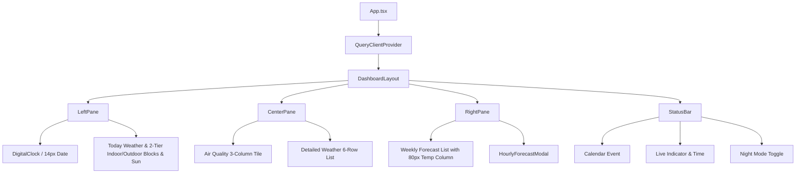

# DESIGN.md - Frontend & System Design Document

> **Project:** Daily Station (Raspberry Pi 卓上ウェザーステーション＆スマートクロック)  
> **Target Display:** 7インチ タッチスクリーン (800 × 480 px 固定解像度)  
> **Status:** Active / Living Document  
> **Frameworks:** React 19, Vite 8, Tailwind CSS v4, shadcn/ui, TanStack Query v5  
> **Last Updated:** 2026-10-13

---

## 1. 概要とデザイン原則 (Executive Summary & Principles)

### 1.1 プロジェクト背景

本システムは、Raspberry Pi 4 および 800×480 タッチディスプレイ上で常時稼働する「SwitchBot スマートデイリーステーション風」の卓上環境ダッシュボード端末です。MagicMirror² 等の過剰なフレームワークを排し、Vite + React による高レスポンスかつ保守性の高い Web フロントエンドを Chromium キオスクモードで運用します。

### 1.2 コアデザイン原則 (Core Design Principles)

1. **800×480 完全固定ビューポート (Zero Overflow)**:
   - 縦横のスクロールバーおよび OS UI を完全排除。すべての情報が 800×480 内に過不足なく美しく収まること。
2. **常時稼働スマートクロックの絶対的自律性 (Self-Correcting Precision Clock)**:
   - 時計は人間が「リロード」をしなくても**永久にミリ秒単位で現在時刻に自己同期し続ける**こと。
   - `setInterval` のようなドリフト（累積ズレ）やブラウザのバックグラウンド間引き・OSスリープに屈しない、次の秒の変わり目（`1000 - Date.now() % 1000`）を狙った自己補正ループを採用。
   - タブ復帰・画面復帰（`visibilitychange`, `focus`, `pageshow`）を常時検知し、瞬時に実時刻へ再吸着するフェイルセーフを保証する。
3. **情報の一目性と単位の視認性 (Legibility & Unit Breathing Room)**:
   - 1行に無理に情報を詰め込んで単位（`℃` や `%`）を圧迫・潰さないこと。
   - ラベル（屋外／室内）とその計測値を 2 段ブロック構造にすることで、横幅のゆとりとカード上下の空間充填を両立する。
4. **SwitchBot ライクな洗練と親しみやすさ**:
   - 角丸カード（`rounded-2xl`）、整理された 1 行グリッド、快適度スマイルフェイス（😊）による温かみのある情報提示。
5. **低刺激・常設最適化 (Night Mode & Low Power)**:
   - 就寝時にも眩しくないダークトーン配色（ナイトモード）の即時切替。
6. **位置情報の秘匿性 (Privacy First)**:
   - 観測地点（緯度・経度・地域名）はコードベースにハードコードせず、`.env.local` 経由で注入。

---

## 2. 画面レイアウト＆スペーシング仕様 (800px × 480px 固定)

```
+-----------------------------------------------------------------------------+
| メイン表示領域 (800px × 438px, 外側パディング: px-2.5 pt-2 pb-1.5, gap-2)   |
| +---------------------+ +-----------------------+ +-----------------------+ |
| | [左ペイン: 268px]   | | [中央ペイン: 288px]   | | [右ペイン: 236px]     | |
| | ・日付 (14px)       | | 【空気質タイル】      | | 【週間天気予報】      | |
| | ・デジタル時計      | |  AQI / PM2.5 / 花粉   | |  今日 (ハイライト)    | |
| | ・今日天気サマリー  | | --------------------- | |  明日以降 6日分リスト | |
| | 【屋外温湿度ブロック| | 【気象詳細リスト】    | |  [Icon] 降水  曜日  高/低℃|
| |   屋外              | |  風速 / 風向 / UV指数 | |  (℃が潰れない80px幅)  | |
| |   🌡 22.8℃  💧 76%  | |  降水確率 / 視程/気圧 | |                       | |
| | 【室内温湿度ブロック| |                       | |                       | |
| |   室内        😊    | |                       | |                       | |
| |   🌡 22.8℃  💧 48%  | |                       | |                       | |
| | ------------------- | |                       | |                       | |
| |  日の出 / 日の入り  | |                       | |                       | |
| +---------------------+ +-----------------------+ +-----------------------+ |
+-----------------------------------------------------------------------------+
| 下部ステータスバー (800px × 42px, px-3 border-t)                             |
| [カレンダー予定: 次のミーティング 19:00]       [最終更新 16:55 ◯] [🌙 ナイト]  |
+-----------------------------------------------------------------------------+
```

### 2.1 左ペイン：温湿度ブロックの 2 段レイアウト仕様

- **課題解消**:
  - 横 1 行への詰め込み（`屋外 🌡 22.8℃ 💧 76%`）を廃止。
  - カード上下の無駄な余白（屋外の上、室内の下のポッカリ空いた空間）を解消。
- **構造**:
  ```text
  [屋外ブロック]
    屋外 (ラベル: text-xs font-bold text-muted-foreground)
    🌡 22.8 ℃        💧 76 %  (text-base font-extrabold, 均等配置)
  [室内ブロック]
    室内             😊 (ラベル & スマイルアイコン)
    🌡 22.8 ℃        💧 48 %  (text-base font-extrabold, 均等配置)
  ```
- これにより、温度と湿度の数値・アイコン・単位（`℃`, `%`）が一切圧迫されず、堂々と大きく視認可能。

### 2.2 右ペイン：気温（`℃`）の潰れ解消仕様

- **課題解消**:
  - 右端の気温列が幅 64px だと `27 / 20℃` が押し潰される。
- **構造**:
  - アイコン & 降水確率: `w-11` (44px)
  - 曜日: `w-11` (44px)
  - 気温列: **`w-20` (80px)** に拡張。
  - 数値（`text-sm font-bold`）と単位記号 `℃`（`text-[11px] font-semibold text-muted-foreground ml-0.5`）を分離し、ベースラインを美しく整列。絶対に文字潰れを起こさない。

---

## 3. タイポグラフィ＆情報密度 (Typography & Visual Scale)

| 要素                      | フォントサイズ・ウェイト                                     | 意図・改善点                                             |
| :------------------------ | :----------------------------------------------------------- | :------------------------------------------------------- |
| **左ペイン日付**          | `text-sm font-semibold` (`14px`)                             | 部屋の離れた場所からでも今日の日付・曜日が即座に判読可能 |
| **デジタル時計 (時:分)**  | `text-5xl font-extrabold tracking-tight`                     | 主役となる時刻。等幅フォントで揺らぎを防止               |
| **デジタル時計 (秒)**     | `text-2xl font-bold text-muted-foreground`                   | 時:分と同じベースライン（下揃え）にスマートに整列        |
| **屋内外温湿度 (数値)**   | **`text-base font-extrabold font-mono` (`16px`)**            | 2段ブロック化により拡大。`℃` と `%` が潰れず快適         |
| **快適度アイコン**        | `text-sm` (絵文字 😊)                                        | 室内ラベル横に自然に配置                                 |
| **空気質 (AQI / PM2.5)**  | `text-lg font-bold font-mono` (`18px`)                       | タイル内の空間を適正に充填                               |
| **気象詳細リスト**        | ラベル `text-xs font-medium` / 数値 `text-sm font-bold`      | アイコンと数値のメリハリをつけ、間延びを解消             |
| **週間予報 (曜日・気温)** | 曜日 `text-sm font-bold` / 気温 `text-sm font-bold` (幅80px) | `℃` 単位を潰さず 80px 幅で優雅に収容                     |

---

## 4. コンポーネント構成と階層 (Component Architecture)



---

## 5. AI エージェント＆開発者向けコーディング規約 (Rules for AI & Devs)

1. **常時稼働スマートクロックの自律性**:
   - 時計機能はリロード不要で永続動作すること。
   - スリープ復帰・非表示復帰時の自動リカバリイベントハンドラを絶対に削除しないこと。
2. **レイアウト不変性の厳守 (800x480)**:
   - 全体枠は `w-[800px] h-[480px] overflow-hidden` を維持すること。
   - 文字列や数値には必ず `whitespace-nowrap` を指定し、度記号（`°`）やパーセント（`%`）が絶対に改行・縦落ちしないようにすること。
3. **単位記号の余白保証 (Unit Breathing Room)**:
   - `℃` や `%` などの単位記号を無理な横1行詰め込みで押し潰さないこと。
   - 列幅は実測フォント幅に対して余裕を持たせること。
4. **コミット規約**:
   - Conventional Commits (`feat:`, `fix:`, `chore:`, `docs:`) に従うこと。
